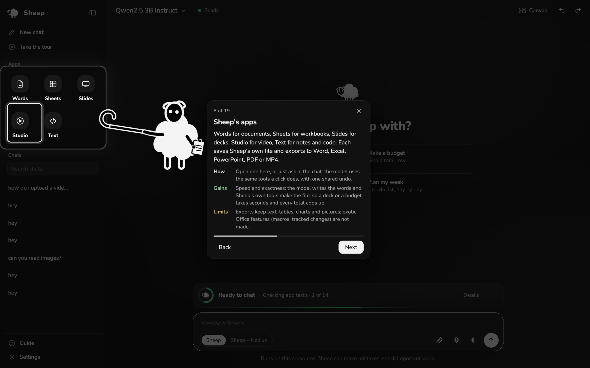
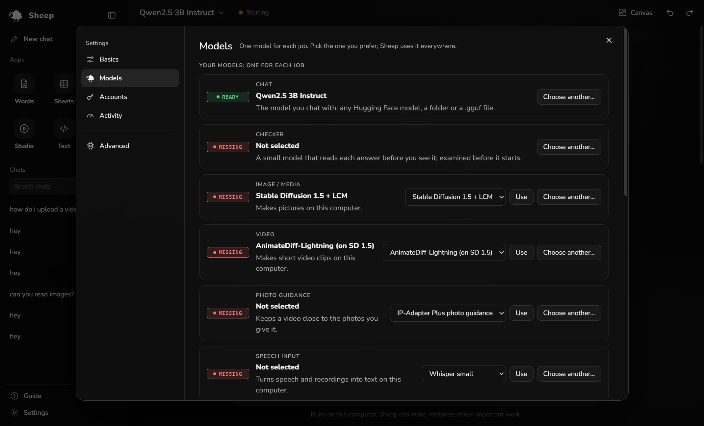
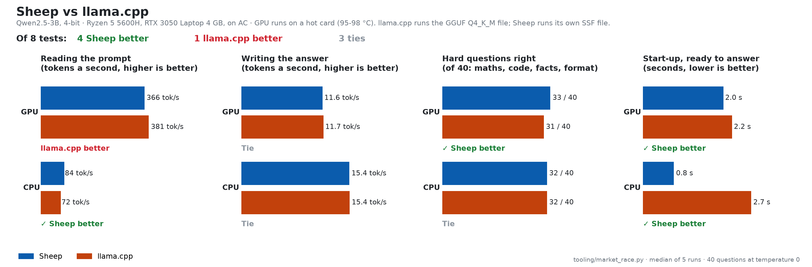

# Sheep

**A personal AI that makes real files on your own computer.** Ask in plain words for a slide deck, a
document, a spreadsheet or a video: Sheep makes it in its own apps and exports it to PowerPoint, Word, Excel
or MP4. The AI model runs on your laptop in Sheep's own engine, and **NVIDIA Nemotron on Nebius** plans the
big jobs, checks the local model's drafts, and answers while the local model loads. **Tavily** brings in
current facts, with their sources.

Sheep is for people with an ordinary laptop, a slow or costly connection, or work that should stay on their
own machine. It was built in Uganda.



## Download

**[Download Sheep for Windows (Sheep-Setup.exe)](https://github.com/ernestkibz/Sheep/releases/latest/download/Sheep-Setup.exe)**
· Windows 10 or 11, 64-bit · about 100 MB · [all releases](https://github.com/ernestkibz/Sheep/releases)

Run it and follow the steps; Sheep opens when it is done. The first start downloads what it needs (Python
and the app's packages, once). No NVIDIA card is needed: Sheep uses the processor when there is none.

## For judges: try it in two minutes

1. On Windows 10 or 11 (64-bit), download [Sheep-Setup.exe](https://github.com/ernestkibz/Sheep/releases/latest/download/Sheep-Setup.exe) and
   install it. No NVIDIA GPU is needed; Sheep uses the processor when there is none.
2. Open **Settings › Accounts**, paste the judges' keys from the Devpost
   testing instructions, and press **Save**.
3. Close Settings and click **Start now with Nemotron on Nebius** on the welcome screen. Ask
   `powerpoint about the history of coffee`; when the deck is made, type `pptx`.
4. Ask `make a presentation about the latest NVIDIA Nemotron models`: Sheep searches with Tavily first, and
   the deck ends with a Sources slide.
5. Add a local model: **Settings › Models › Add any model**, for example `Qwen/Qwen2.5-1.5B-Instruct`, then
   **Check** and **Build**. Watch **Settings › Activity › What Sheep did for you**: Sheep finds the
   original weights, builds them for your computer, places the model, and checks it on real app jobs.

## Any model, with nothing to set

Give Sheep a model the way you would name it: a Hugging Face ID, a folder, or a `.gguf` file. A GGUF, GPTQ,
AWQ, EXL2 or MLX page is traced back to the original it was made from, and built from that. A fine-tune that
exists only as a GGUF or GPTQ copy is converted first. An architecture Sheep's engine has not met is fitted to
it, or runs in compatibility mode with the maker's own code. The level is chosen for your computer's memory,
the model is placed on the graphics card, the processor or both, and it is checked before you rely on it. You
set nothing. [docs/MODELS.md](docs/MODELS.md) has every step and every format.



## How Sheep uses Nebius, NVIDIA Nemotron and Tavily

| What | Where it runs | What it does in Sheep |
|---|---|---|
| **NVIDIA Nemotron 3 Super 120B-A12B** (and Nano) | Nebius Token Factory, called directly (`https://api.tokenfactory.nebius.com/v1`) | Plans a multi-step job as exact tool calls that Sheep runs on the computer; checks the local model's draft against the request before Sheep makes the file; answers while the local model loads or is being repaired |
| **A local model** (Qwen, Llama, Gemma, Phi, Mistral, NVIDIA Nemotron-H and [many more](docs/MODELS.md#architecture-support)) | This computer, in Sheep's own engine (SML + SSF) | Writes the content; Sheep makes the files with its apps' own tools |
| **Tavily** | Web search API | Current facts for questions, and for decks and documents, which end with their sources |

Every request that leaves the computer is listed in **Settings › Advanced › Sent out**, with the provider that answered
it and that provider's id for the call. Keys go in Settings › Accounts, or in the environment variables
`NEBIUS_API_KEY`, `NEBIUS_BASE_URL` (the default is Token Factory, `https://api.tokenfactory.nebius.com/v1`),
`NEBIUS_MODEL` and `TAVILY_API_KEY`. In **Sheep** mode nothing leaves the computer; without a Tavily key, web
search uses a keyless public search.

## What is inside

| App | Format | Exports |
|---|---|---|
| **Words** | .sdoc | .docx, .md, .pdf |
| **Sheets** | .ssheet | .xlsx, .csv, .pdf |
| **Slides** | .sdeck | .pptx, .pdf |
| **Studio** | .sstudio | .mp4 |
| **Text** | .txt, .md, .py, .js, … | |
| **Work Canvas** | blocks: pin, drag, run code | |

Every editor runs the same tools the model calls: a click and a model's tool call are the same operation, land
in the same file, and share one undo. Also: attachments (pictures, documents, sheets, slides, PDFs), web search
with sources, voice and captions in Studio, pictures read on this computer, email over IMAP/SMTP and calendar
as .ics, and custom tools the model writes for itself.

**The orchestrator** is the model's admin. It finds your hardware, plans where the model runs, checks it (a
first exam, check questions with known answers, then real jobs in the apps, each checked by opening what was
made), paces itself when the laptop is hot or on battery, and repairs a model that starts to misbehave. Every
check and repair is shown in **Settings › Activity**.

## The engine

Sheep's engine (**SML**) and file format (**SSF**) were built during the hackathon. The claims, their limits
and every number are in [docs/ENGINE.md](docs/ENGINE.md) and [RESULTS.md](RESULTS.md).

### Raced against llama.cpp and Ollama on one laptop

Ryzen 5 5600H, RTX 3050 Laptop 4 GB, on AC; Qwen2.5-3B at 4 bits on all three engines (Sheep's SSF,
the others' GGUF Q4_K_M), each as a server, median of the runs, 40 hard questions at temperature 0.
Every graph names its winner per test, losses included. Made by `tooling/benchmark_charts.py` from the
race logs.

| Graph | What it compares |
|---|---|
| [Sheep vs llama.cpp](mlmi/media/bench/sheep_vs_llamacpp.png) | Reading, writing, answers right, start-up, on the GPU and the CPU |
| [Sheep vs Ollama](mlmi/media/bench/sheep_vs_ollama.png) | The same four, against Ollama |
| [SML vs GGML](mlmi/media/bench/sml_vs_ggml.png) | The engines alone: 8-round ABBA races with 95% ranges, and as whole servers |
| [SSF vs GGUF](mlmi/media/bench/ssf_vs_gguf.png) | The files: closeness to the original model, same next word, size, on three models |
| [Hardware put to work](mlmi/media/bench/hardware.png) | How much of the card each engine uses, how busy it keeps it, and words written per watt |
| [Features](mlmi/media/bench/features.png) | What each does besides running a model |
| [Too big for the card](mlmi/media/bench/big_model.png) | Qwen2.5-7B on the 4 GB card, split by each engine its own way |



**A model too big for the card.** Qwen2.5-7B at 4 bits (4.7 GB) does not fit a 4 GB card, so each engine
splits it between the card and the processor. Sheep now reads a prompt on the card for every layer, copying
the processor's layers across one at a time: its prompt reading went from 57 to 123 tokens a second in the
race. Ollama still reads faster (138) and llama.cpp writes faster (6.6 against Sheep's 5.0); Sheep beats
llama.cpp's prompt reading five times over (25). [The graph](mlmi/media/bench/big_model.png) has all four.

## Built during the hackathon

This repository began on 2026-08-29 as a fork of an MIT-licensed C/C++ inference engine. The submission
period opened on 2026-08-26. Every file that came from upstream has since been deleted and replaced
([NOTICE](NOTICE), [PROVENANCE.md](PROVENANCE.md)), and the dated commits record what was built since then.
[docs/DEVELOPMENT_HISTORY.md](docs/DEVELOPMENT_HISTORY.md) walks through every stage.

## Honest limits

- The desktop app and installer are Windows only. The engine builds on Linux.
- The engine's speed wins are measured on one laptop with AVX2; on other CPUs, ARM or Mac, assume llama.cpp is
  faster.
- Compatibility mode (the maker's own code) is correct but slower than Sheep's engine.
- Small local models make mistakes; in Sheep + Nebius mode Nemotron checks their work, and every check is shown.
- Qwen2.5-3B, used in the tests, has a research licence; pick an Apache-2.0 model for real work.

## Docs

| Page | For |
|---|---|
| [User guide](docs/USER_GUIDE.md) | Using Sheep |
| [Models](docs/MODELS.md) | Which models work, formats in and refused, publishing |
| [Architecture](docs/ARCHITECTURE.md) | The parts, one request's path, the code map |
| [Engine](docs/ENGINE.md) | SML and SSF, the races, what can and cannot be claimed |
| [Building](docs/BUILDING.md) | The engine, the app from source, the installer |
| [Testing](docs/TESTING.md) | Unit tests, photos, journeys, the proof pass |
| [Development history](docs/DEVELOPMENT_HISTORY.md) | Every stage, with its proof |
| [Evidence](docs/evidence/README.md) | Routing evidence, results, parity, sprint records |
| [Changelog](CHANGELOG.md) | What changed, by date |

## From source

```
python -m pip install .
cd mlmi/desktop && npm install && cd ../..
Sheep.cmd
```

Needs Windows 10 or later, Python 3.9+ and Node.js. An NVIDIA GPU with 4 GB or more helps; the
processor alone works. [docs/BUILDING.md](docs/BUILDING.md) builds the engine and the installer.

## Licence

MIT. See [LICENSE](LICENSE) and [NOTICE](NOTICE): this began as a fork and the attribution stands.
